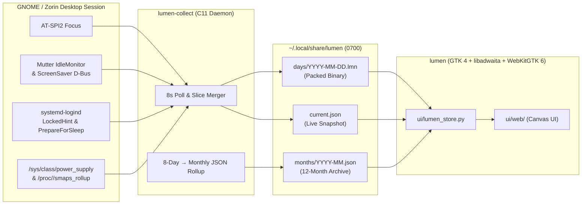

<div align="center">


# Lumen

**Native, Privacy-First Digital Wellbeing & Battery Telemetry for Linux Desktops**

[](https://github.com/hurairamuzammal/linux-lumen/releases/tag/v1.0.0)
[](https://github.com/hurairamuzammal/linux-lumen)
[-2ec27e?style=for-the-badge)](src/lumen-collect.c)
[](ui/lumen_app.py)
[](LICENSE)

<p align="center">
  <em>A tiny ~32 KB C11 daemon records screen time, idle, lock, suspend, and battery slices in the background.<br/>
  The GTK 4 + libadwaita dashboard runs <strong>only when you open it</strong>—consuming zero UI memory the rest of the day.</em>
</p>

[Features](#-features) •
[Architecture](#-architecture--storage-format) •
[Installation Guide](#-installation-guide) •
[CLI & Service Usage](#-cli--service-usage) •
[Privacy & Security](#-privacy--security) •
[Development](#-development--testing)

</div>

---

## ✨ Why Lumen?

Most desktop time trackers either run a heavy Electron/Python process in the background 24/7 or log invasive metadata like window titles, URLs, and keystrokes.

**Lumen is built differently:**
1. **Tiny Native Footprint:** The background recorder (`lumen-collect`) is a ~32 KB compiled C11 binary running at `Nice=10` and `IOSchedulingClass=idle` with a strict `32 MB` systemd memory cap (typically using **~3–5 MB RSS**).
2. **Zero Boot Delay:** Runs strictly as a `systemd --user` service bound to `graphical-session.target`. It starts **after** your desktop session logs in and stops cleanly on logout—never delaying kernel boot or GDM.
3. **On-Demand UI:** The GTK 4 / libadwaita + WebKitGTK 6 interface (`lumen`) does not stay resident in the system tray or background. When you close the window, the UI process exits completely.
4. **Strict Privacy by Design:** Window titles, URLs, file names, keystrokes, and screenshots are **never** read or stored. All telemetry lives locally in `~/.local/share/lumen` with strict `0700` / `0600` owner-only permissions and zero network access.

---

## 🚀 Features

| View / Capability | Description |
| :--- | :--- |
| **Today Dashboard** | Live-updating active screen time, idle counter, current focused app indicator, 24-hour activity area chart, and ranked app usage list. |
| **7-Day Activity & Rings** | Stacked weekly usage/idle/lock bar chart, interactive daily progress ring cards with hover KPIs, and an inline Day Inspector with full timeline drill-down. |
| **Apps & Fuzzy Search** | Instant fuzzy-matched search (exact, substring, subsequence, and Levenshtein typo tolerance) with match highlighting, 7-day totals, daily averages, and peak RSS memory tracking per app. |
| **Battery Telemetry & Health** | Live `/sys/class/power_supply` diagnostics: charge curve canvas, real-time wattage draw (`W`), voltage (`V`), capacity (`Wh`), battery health (`%`), cycle count, and time-to-full / time-to-empty ETA. |
| **12-Month Heatmap Calendar** | Interactive monthly heatmap calendar with 4 intensity tiers, monthly screen-time KPIs, top apps of the month, and seamless inspection of both recent (detailed) and older (rolled-up) days. |
| **Sunday Letter** | Weekly reflection sheet comparing your Monday–Sunday screen time against the previous week with delta percentages and top apps. |
| **Zorin OS & GTK Accent Sync** | Automatically extracts `@define-color` accent and window tokens from your active GTK 4 / Zorin OS theme (`ZorinBlue`, `ZorinYellow`, `ZorinGreen`, `Adwaita`, etc.) and updates live when you switch themes or Light/Dark mode. |
| **One-Click Pause** | Pause tracking at any time from the header menu (`☰ → Pause tracking`). Pausing disables and stops `lumen-collect.service` so even a reboot won't resume tracking until you explicitly click **Resume**. |

---

## 🏗️ Architecture & Storage Format



### The `.lmn` Packed Binary Format (`LMN1`)
Instead of running an embedded SQLite database that wakes the disk with WAL checkpoints, `lumen-collect` merges consecutive unchanged intervals in memory and writes a compact binary day file (`~/.local/share/lumen/days/YYYY-MM-DD.lmn`, capped at 3 MB):

- **Header (`128 bytes`):** Magic `"LMN1"`, format version (`1`), `first_boot` timestamp, `last_flush` timestamp, cumulative `sleep_sec`, record count, and reserved padding.
- **Record Type `1` (Interval):** `u8 type=1` | `u32 start_ts` | `u16 duration_sec` | `u8 state` (`0=active`, `1=idle`, `2=lock`, `3=sleep`) | `u32 rss_kb` | `u8 name_len` | `char name[name_len]`.
- **Record Type `2` (Battery Sample):** `u8 type=2` | `u32 ts` | `u8 pct` | `u8 status` | `u16 power_mw`.
- **Record Type `3` (Suspend Span):** `u8 type=3` | `u32 sleep_start` | `u32 wake_end` (computed via `CLOCK_BOOTTIME - CLOCK_MONOTONIC`).

### Automatic Data Retention & Rollup
- **Last 8 Days (`days/*.lmn`):** Full hourly timelines, per-slice app intervals, RAM peaks, and battery curves are kept for today plus the past 7 days.
- **Up to 12 Months (`months/YYYY-MM.json`):** Days older than 8 days are automatically rolled up into compact monthly JSON summaries (retaining daily active/idle/lock/sleep totals and per-app totals) and the raw `.lmn` file is unlinked. Monthly archives older than 12 months are automatically pruned.

---

## 📦 Installation Guide

### 1. Install System Dependencies

Lumen requires **GTK 4**, **libadwaita 1**, **WebKitGTK 6.0**, **PyGObject**, **GLib 2.0**, and **AT-SPI2**.

#### Ubuntu 24.04+ / Zorin OS 17 & 18 / Debian 12+ / Linux Mint
```bash
sudo apt update
sudo apt install -y \
  build-essential pkg-config git \
  libglib2.0-dev libatspi2.0-dev \
  python3 python3-gi python3-gi-cairo \
  gir1.2-gtk-4.0 gir1.2-adw-1 gir1.2-webkit-6.0
```

#### Fedora 39+ / RHEL 9+
```bash
sudo dnf install -y \
  gcc make pkgconf-pkg-config git \
  glib2-devel at-spi2-core-devel \
  python3 python3-gobject \
  gtk4 libadwaita webkitgtk6.0
```

#### Arch Linux / Manjaro
```bash
sudo pacman -S --needed \
  base-devel pkgconf git \
  glib2 at-spi2-core \
  python python-gobject \
  gtk4 libadwaita webkitgtk-6.0
```

> **Note on Accessibility Bus (AT-SPI2):** Lumen uses the standard GNOME AT-SPI2 bus to detect which application is focused without reading window titles. Ensure desktop accessibility is active (enabled by default on Zorin OS and Ubuntu):
> ```bash
> gsettings set org.gnome.desktop.interface toolkit-accessibility true
> ```

---

### 2. Install Lumen

#### Option A: Install from Prebuilt Release (`v1.0.0` — Recommended)
Download the latest release archive for Linux `x86_64` and run the installer:
```bash
curl -fL https://github.com/hurairamuzammal/linux-lumen/releases/download/v1.0.0/lumen-v1.0.0-linux-x86_64.tar.gz -o lumen-v1.0.0-linux-x86_64.tar.gz
tar -xzf lumen-v1.0.0-linux-x86_64.tar.gz
cd lumen-v1.0.0-linux-x86_64
./scripts/install.sh
```

#### Option B: Clone & Build from Source
```bash
git clone https://github.com/hurairamuzammal/linux-lumen.git
cd linux-lumen
chmod +x scripts/install.sh scripts/lumen
./scripts/install.sh
```

Ensure `~/.local/bin` is in your `PATH` (standard on most distributions):
```bash
export PATH="$HOME/.local/bin:$PATH"
```

---

### 3. Verify Installation

Check that the background collector service is active and recording:
```bash
systemctl --user status lumen-collect.service
lumen status
```

Launch the desktop app from your application launcher (**Activities → Lumen**) or run:
```bash
lumen
```

---

### 4. Uninstallation

To stop the collector service and remove all installed binaries, icons, and desktop entries from `~/.local`:
```bash
make uninstall
```
*(Your personal history in `~/.local/share/lumen` and settings in `~/.config/lumen` are preserved unless you delete them manually with `rm -rf ~/.local/share/lumen ~/.config/lumen`.)*

---

## 🖥️ CLI & Service Usage

```text
Usage: lumen [COMMAND]

Commands:
  (none)              Launch the Lumen GTK 4 / libadwaita desktop app
  status, --status    Print the collector's live current.json snapshot
  collect, --collect  Run the lumen-collect background daemon directly
  version, --version  Print version information (Lumen 1.0.0)
  help, --help        Show help message
```

### Direct Collector Diagnostics
You can test a single poll cycle in your terminal without touching the running daemon or modifying day files:
```bash
~/.local/bin/lumen-collect --once
# Example output:
# app=code pid=41820 ram_kb=384120 idle_ms=0 locked=0 batt=84 status=0 power_mw=11400 suspend_sec=0
```

### Configuration Files
Lumen stores its configuration in `~/.config/lumen/`:

- **`~/.config/lumen/collector.conf`** (picked up live on the next poll tick via `mtime` check):
  ```ini
  # lumen collector
  idle_sec=180
  poll_sec=8
  paused=0
  ```
  - `idle_sec`: Seconds of user inactivity before transitioning from `active` to `idle` (clamped between `30` and `3600`, default `180`).
  - `poll_sec`: Poll interval in seconds (clamped between `3` and `60`, default `8`).
  - `paused`: `1` when tracking is paused, `0` when active.
- **`~/.config/lumen/ui.json`**:
  ```json
  {
    "display_name": "Huraira",
    "theme": "system"
  }
  ```

---

## 🔒 Privacy & Security

| Recorded Locally (`~/.local/share/lumen`) | Never Recorded or Accessed |
| :--- | :--- |
| ✅ Focused application name (e.g., `Firefox`, `VS Code`) | ❌ Window titles, browser tabs, or document names |
| ✅ Session state (`active`, `idle`, `lock`, `sleep`) | ❌ Keystrokes, mouse coordinates, or clipboard text |
| ✅ Focused process RSS memory (`ram_kb`) | ❌ Screenshots, camera, or audio |
| ✅ Battery percentage, status, and power draw (`mW`) | ❌ Network traffic, telemetry, or cloud sync |

### Security Hardening in v1.0.0
- **Strict File Permissions (`0700` / `0600`):** Both `lumen-collect` (`umask(0077)`) and `lumen_store.py` enforce `0700` directory permissions and `0600` atomic file writes so other local users on a shared system cannot read your activity history.
- **Binary Hardening:** `lumen-collect` is compiled with `-fstack-protector-strong`, `-D_FORTIFY_SOURCE=2`, `-fPIE`, and linked with full RELRO (`-Wl,-z,relro,-z,now -pie`).
- **WebView Isolation:** The GTK 4 WebKit view disables universal access from file URLs (`set_allow_universal_access_from_file_urls(False)`), disables developer extras in production, and enforces a strict navigation policy (`decide-policy`) that blocks any navigation outside the local `index.html` bundle.
- **PID Verification:** Before sending `SIGTERM` when pausing tracking, Lumen verifies `/proc/<pid>/comm` matches `lumen-collect`, preventing accidental signaling of recycled PIDs.
- **Systemd Sandboxing:** `lumen-collect.service` runs as an unprivileged user unit with `NoNewPrivileges=yes`, `PrivateTmp=yes`, `LockPersonality=yes`, and `MemoryMax=32M`.

See [SECURITY.md](SECURITY.md) for full details and vulnerability reporting.

---

## 🛠️ Development & Testing

```bash
# 1. Compile the native C11 collector
make collect

# 2. Run the unit test suite (7-day calendar, live slice folding, pause & security tests)
make test

# 3. Build a distributable release tarball + SHA-256 checksum in build/
make dist
```

### Project Layout
```text
linux-lumen/
├── src/
│   └── lumen-collect.c                  # Native C11 background collector daemon
├── ui/
│   ├── lumen_app.py                     # GTK 4 + libadwaita + WebKitGTK 6 application shell
│   ├── lumen_store.py                   # Binary .lmn parser, sysfs battery reader, rollup & state engine
│   └── web/
│       ├── index.html                   # Dashboard entry point
│       ├── app.js                       # Views, canvas charts, fuzzy search & live DOM patching
│       ├── styles.css                   # Responsive styles & dynamic theme tokens
│       └── fonts/                       # Bundled offline fonts (Outfit, Caveat, Permanent Marker)
├── scripts/
│   ├── install.sh                       # One-step builder, installer & systemd user unit configurator
│   └── lumen                            # CLI launcher wrapper
├── packaging/
│   ├── org.lumen.Wellbeing.desktop      # XDG desktop entry
│   ├── icons/org.lumen.Wellbeing.svg    # Scalable app icon
│   └── systemd/lumen-collect.service    # Hardened systemd user service unit
├── tests/
│   ├── test_calendar.py                 # 7-day .lmn & 12-month rollup unit tests
│   ├── test_live.py                     # Live open-slice folding tests
│   └── test_pause.py                    # Service pause/resume & security hardening tests
├── Makefile                             # Build, test, install, uninstall & dist targets
├── SECURITY.md                          # Security architecture & reporting policy
└── LICENSE                              # MIT License
```

---

## 📄 License

Released under the [MIT License](LICENSE). Bundled fonts in `ui/web/fonts/` carry their respective Open Font License (OFL) and Apache notices.
